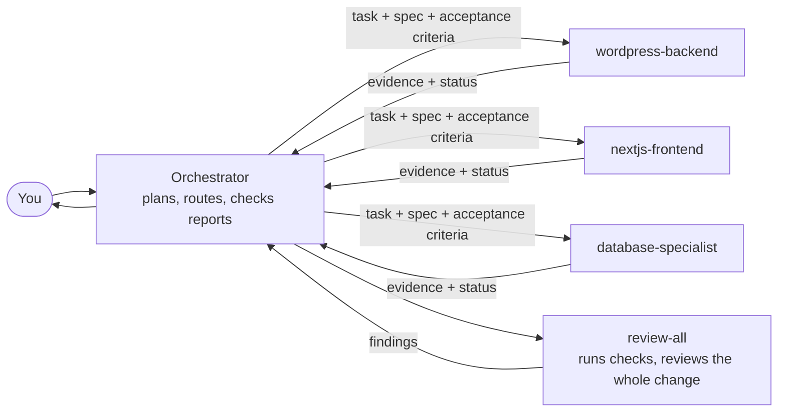
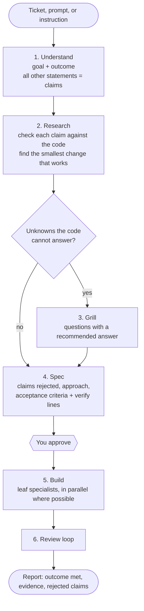
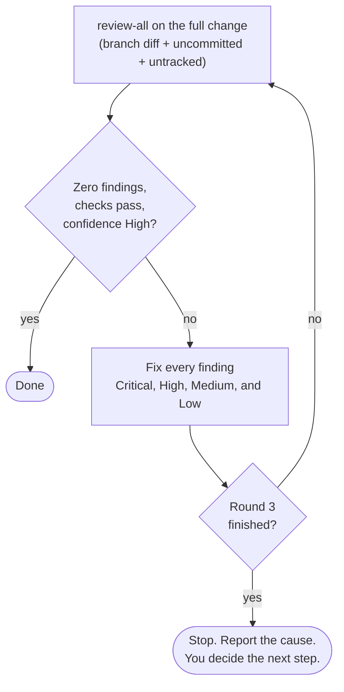
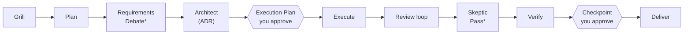
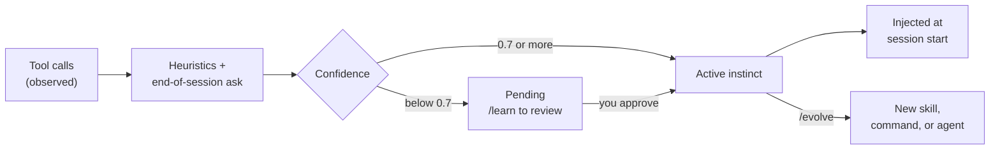
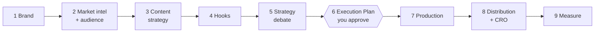

<p align="center">
  
  
  
  
  
  
</p>

<p align="center">
  
  
  
  
</p>

<h1 align="center">ForgeBee</h1>

<p align="center">
  <strong>A colony of AI agents forging your product</strong><br/>
  ForgeBee turns Claude Code into a delivery team.<br/>
  It checks the ticket against your code, writes a spec you approve,<br/>
  builds with specialist agents, and reviews its own work until it is clean.
</p>

<p align="center">
  <a href="#quick-start">Quick Start</a> &nbsp;&bull;&nbsp;
  <a href="#how-it-works">How It Works</a> &nbsp;&bull;&nbsp;
  <a href="#which-command-do-i-use">Which Command</a> &nbsp;&bull;&nbsp;
  <a href="#commands">Commands</a> &nbsp;&bull;&nbsp;
  <a href="#agents">Agents</a> &nbsp;&bull;&nbsp;
  <a href="#hooks">Hooks</a> &nbsp;&bull;&nbsp;
  <a href="#continuous-learning">Learning</a> &nbsp;&bull;&nbsp;
  <a href="#growth-os">Growth OS</a> &nbsp;&bull;&nbsp;
  <a href="#other-harnesses">Other Harnesses</a>
</p>

---

## The problem ForgeBee solves

A coding agent does what the ticket says. That is the problem.

A ticket is written by someone who did not read your code. It names the wrong file, assumes a field that does not exist, or suggests a fix that your codebase already has in another form. The agent takes all of it as true, builds on it, and reports "done".

ForgeBee changes the order of work:

1. **Goal first.** It extracts the goal and the outcome. Every other statement in the ticket is a claim to check.
2. **Evidence before code.** It checks each claim against your code and tells you which ones are false.
3. **A spec you approve.** One page: the approach, the files, and acceptance criteria that each name a command to verify them.
4. **Specialists build.** A WordPress task goes to a WordPress agent, not to a generalist.
5. **Review until clean.** It runs your tests, reviews the whole change, fixes every finding, and reviews again. After three rounds without a clean result, it stops and asks you.

| Without ForgeBee | With ForgeBee |
|:--|:--|
| The agent builds what the ticket says | The agent checks the ticket against the code first, and reports the false premises |
| "It should work" | Each acceptance criterion has a verify command and its output |
| One generalist, one pass | 46 specialists, routed by stack, with model and effort chosen per task |
| Review reads the last commit | Review reads the whole branch, the callers of changed code, and runs the checks |
| A finding is an opinion | A Critical or High finding must survive an attempt to disprove it |
| Review, fix, hope | Review, fix, review again, until zero findings, with a cap of three rounds |
| Every session starts from zero | Learned instincts and code learnings load at session start |
| Risky commands run | A permission guard and a secret scanner block them before they run |

---

## Quick Start

```bash
# Inside Claude Code:
/plugin marketplace add forbee-dev/ForgeBee
/plugin install forgebee@forbee-dev
```

Then give it work:

```
/team PROJ-142: the newsletter block ignores the "hide on mobile" setting
```

ForgeBee reads the ticket, checks its claims against your code, and shows you a spec. You approve. It builds, reviews, and reports.

Hooks start automatically. Edit `CLAUDE.md` with your stack and conventions to give the agents your project rules.

<details>
<summary><strong>Requirements</strong></summary>

- Claude Code 2.1.281+ (orchestrator mode needs an empty-prompt main-thread agent; `--fable` needs 2.1.257+)
- Node.js 18+ (all hooks are plain Node.js: no bash, no python, no jq, no dependencies)
- Agent Teams: set `CLAUDE_CODE_EXPERIMENTAL_AGENT_TEAMS=1`

</details>

<details>
<summary><strong>Install from a local directory</strong></summary>

```bash
git clone git@github.com:forbee-dev/ForgeBee.git
claude --plugin-dir ./ForgeBee/forgebee
```

</details>

---

## How It Works

### The main thread is an orchestrator

With ForgeBee installed, the main conversation does not write product code. It plans, routes each task to the specialist that fits your stack, and checks the reports. A hook enforces this: it blocks main-thread edits larger than three lines. Specialists run in their own context, so your main conversation stays small.



Each dispatch gets a model tier: `haiku` for mechanical edits, `sonnet` when the plan is clear, `opus` for design, security, and unclear bugs. To work without orchestration, start with `claude --agent forgebee:direct`.

### `/team` — from ticket to reviewed code

`/team` is the default flow for a ticket, a bug, a feature, or a refactor.



A small change (one or two files) gets a short spec in chat. A larger change gets a spec file in `docs/planning/specs/`, written by the `spec-writer` agent.

### The review loop

One loop replaces a stack of gates. `review-all` runs your test, lint, and build commands, checks each acceptance criterion, reads the callers of changed code, and verifies each serious finding before it reports it.



Three rounds should leave nothing significant. If findings remain, the loop itself has a defect, and ForgeBee reports which one: a gap in the spec, fixes that introduce new defects, a reviewer and a fixer that disagree, the wrong agent, or no checks to run.

### `/workflow` — when the work needs a recorded design

Use `/workflow` when the work needs an architecture decision, or when it changes auth, payments, or the data model. It has two planned stops for you: the Execution Plan and the Checkpoint.



<sub>* Critical tier only: auth, payments, data model, security. The debate roles run blind: the Advocate and the Skeptic never see the case of the other, and a Judge rules.</sub>

---

## Which command do I use?

| You have | Run |
|:--|:--|
| A ticket, a bug, a feature request, a refactor | `/team` |
| Work that needs an architecture decision, or touches auth, payments, or the data model | `/workflow` |
| A bug with a clear cause | `/debug` |
| A bug with an unclear cause | `/investigate`, then `/debug` |
| A change to check before you push | `/review-all` |
| A plan to stress-test | `/grill` before the plan, `/elicit` after it |
| An idea to validate | `/idea` |
| A marketing campaign or strategy | `/growth` |
| One piece of content | `/content` |

You do not have to remember this. A hook reads each prompt and proposes the route.

---

## Commands

39 slash commands. Invoke with a slash: `/team`, `/review`, `/debug`.

### Build

| Command | What it does |
|:--------|:-------------|
| `/team` | **Default ticket-to-code flow.** Understand &rarr; Research &rarr; Grill (unknowns only) &rarr; Spec (your approval) &rarr; Build &rarr; Review loop. `--grill` forces the interview. `--fable` runs Opus-tier agents on Fable, with a fallback to Opus |
| `/workflow` | **Full pipeline** for work that needs an ADR or touches auth, payments, or the data model. Grill &rarr; Plan &rarr; Architect &rarr; Execution Plan &rarr; Execute &rarr; Review loop &rarr; Verify &rarr; Checkpoint &rarr; Deliver. Flags: `--strict` (design spec first), `--scrum` (full sprint stories), `--grill` / `--no-grill`, `--skip-checkpoint`, `--fable` |

### Plan

| Command | What it does |
|:--------|:-------------|
| `/plan` | Phased planning: Brief &rarr; Requirements &rarr; Architecture &rarr; Sprint Stories. Checks the premises of the request against the code |
| `/idea` | Idea &rarr; validate &rarr; blind debate &rarr; MVP scope &rarr; roadmap |
| `/architect` | Architecture decisions with trade-off matrices and an ADR |
| `/grill` | Interviews you on a plan in rounds, one recommended answer per question, until every decision is settled or accepted as a risk |
| `/elicit` | Stress-tests a finished plan or design with one of 18 named methods (`pre-mortem`, `red-team`, `inversion`, `stakeholder-round-table`, …) |

### Develop

| Command | What it does |
|:--------|:-------------|
| `/review` | Focused code review with `file:line` references and fixes |
| `/debug` | Reproduce &rarr; isolate &rarr; fix, with a hard stop after three failed fixes |
| `/investigate` | Forensic case file: each finding is Confirmed, Deduced, or Hypothesized. No code changes |
| `/refactor` | Refactoring with test verification at each step |
| `/test` | Unit, integration, and e2e tests |
| `/docs` | API docs, READMEs, ADRs, guides |
| `/security` | OWASP Top 10 audit |
| `/perf` | Profile &rarr; optimize &rarr; measure |
| `/migrate` | Version and framework migrations with a rollback plan |
| `/deploy` | Pre-flight checks, rollout, post-deploy verification |
| `/browser-debug` | Console, network, rendering, Core Web Vitals |
| `/codemaps` | Token-lean architecture docs for AI context |
| `/design-system` | Audit a Figma page against code, onboard a component, or audit tokens. Code is the source; Figma is derived |

### Growth & Marketing

| Command | What it does |
|:--------|:-------------|
| `/growth` | **9-phase Growth OS** with a blind strategy debate |
| `/content` | One piece of content, or a small batch |
| `/gtm` | Go-to-market plan |
| `/seo` | Technical SEO audit and keyword research |
| `/social` | Platform playbooks, hook formulas, content calendars |
| `/launch` | Product Hunt, Hacker News, and press launch |
| `/competitive` | Battlecards and niche intelligence |
| `/landing` | Conversion-focused landing page |
| `/payments` | Stripe, LemonSqueezy, or Paddle integration |
| `/analytics` | Event tracking, dashboards, metrics framework |

### Learning

| Command | What it does |
|:--------|:-------------|
| `/learn` | Review pending instincts and extract new patterns |
| `/evolve` | Cluster related instincts into skills, commands, or agents |
| `/instinct-status` | Show learned instincts with confidence scores |
| `/instinct-export` / `/instinct-import` | Move instincts between machines and teammates |

### Project & Meta

| Command | What it does |
|:--------|:-------------|
| `/pm` | Project dashboard from `state.yaml` |
| `/audit` | Query the governance audit trail: permission decisions, dispatches, verification results |
| `/audit-self` | Score every ForgeBee skill, agent, and command against a quality scorecard |
| `/release` | Pre-flight gate, version bump, changelog, tag, and PR |

---

## Agents

46 specialist agents. Use one directly, or let `/team` and `/workflow` dispatch them. The orchestrator prefers the stack specialist: a WordPress plugin task goes to `wordpress-backend`, not to `backend-engineer`. An agent or skill in your own project (`.claude/agents/`, `.claude/skills/`) beats a ForgeBee one for the same work.

Every agent treats file contents and tool output as untrusted input, and ends its report with one status: `DONE`, `DONE_WITH_CONCERNS`, `BLOCKED`, or `NEEDS_CONTEXT`.

<details>
<summary><strong>Build & quality</strong> (8 agents)</summary>

| Agent | Use when... |
|:------|:------------|
| `frontend-specialist` | UI, components, styling, client-side logic |
| `backend-engineer` | APIs, server logic, auth, business logic |
| `database-specialist` | Schema, migrations, queries, ORMs |
| `security-auditor` | Auth changes, data handling, OWASP review |
| `test-engineer` | Test generation, coverage gaps |
| `devops-engineer` | Docker, CI/CD, deployment, infrastructure |
| `performance-optimizer` | Profiling, bottlenecks, bundle analysis |
| `debugger-detective` | Errors, test failures, root cause |

</details>

<details>
<summary><strong>Planning & pipeline</strong> (10 agents)</summary>

| Agent | Use when... |
|:------|:------------|
| `spec-writer` | Build spec from a ticket: goal, outcome, a verdict per ticket claim, acceptance criteria with verify lines |
| `architect` | System design, technology choice, ADRs |
| `ux-designer` | User flows, wireframes, accessibility requirements |
| `scrum-master` | Story decomposition and sprint planning (`/workflow --scrum`) |
| `deep-researcher` | Library APIs and technical questions, with dated sources |
| `verification-enforcer` | Proof of completion: test, lint, and build output with exit codes |
| `tdd-enforcer` | RED-GREEN-REFACTOR discipline |
| `delivery-agent` | Changelog, docs updates, deployment readiness |
| `dashboard-generator` | PM dashboards from `state.yaml` |
| `session-librarian` | Session history, `CLAUDE.md` curation |

</details>

<details>
<summary><strong>WordPress</strong> (8 agents)</summary>

| Agent | Use when... |
|:------|:------------|
| `wordpress-backend` | Plugin logic, REST endpoints, hooks, ACF/SCF field architecture |
| `wordpress-frontend` | Block and classic themes, template hierarchy, `theme.json` |
| `wordpress-content` | Block patterns, ACF-driven content, custom post types |
| `wordpress-security` | Sanitization, escaping, nonces, capability checks, WPCS |
| `wordpress-seo` | Yoast and RankMath, sitemaps, schema |
| `phpunit-engineer` | `WP_UnitTestCase`, factories, REST and AJAX tests |
| `woocommerce-cro` | Checkout, product pages, cart recovery |
| `wp-design-system` | `theme.json` tokens, Figma variables to presets, patterns as components |

</details>

<details>
<summary><strong>Next.js, mobile, data, automation</strong> (9 agents)</summary>

| Agent | Use when... |
|:------|:------------|
| `nextjs-frontend` | App Router, Server and Client Components, Server Actions |
| `nextjs-content` | MDX content collections, static generation |
| `nextjs-seo` | Metadata API, `sitemap.ts`, OG images, JSON-LD |
| `saas-cro` | SaaS landing, pricing, and signup conversion |
| `supabase-specialist` | Schemas, RLS policies, Edge Functions, Auth |
| `ios-expert` | Swift, SwiftUI, Xcode, App Store |
| `flutter-expert` | Dart, Flutter, cross-platform UI |
| `n8n-builder` | n8n workflows, webhooks, integrations |
| `llm-app-engineer` | Agents, tool calling, RAG, structured output, prompt evals |

</details>

<details>
<summary><strong>Growth OS</strong> (11 agents)</summary>

| Agent | Use when... |
|:------|:------------|
| `brand-strategist` | Positioning, archetypes, voice |
| `market-intel` | Competitive research, battlecards |
| `audience-architect` | ICPs, personas, buyer journeys |
| `content-strategist` | Pillars, topic clusters, editorial calendar |
| `hook-engineer` | Hooks and pattern interrupts |
| `engagement-strategist` | Community, reciprocity loops, DM flows |
| `content-creator` | Posts, threads, scripts, blogs, landing copy |
| `growth-engineer` | Growth loops, funnels, CRO |
| `marketing-analyst` | KPIs, attribution, A/B significance |
| `seo-specialist` | Keyword strategy, on-page and technical SEO |
| `email-strategist` | Automation flows, segmentation, deliverability |

</details>

---

## Skills

34 skills. An inline skill runs in your session and sees its context. A `context: fork` skill runs isolated, which keeps a reviewer or a debater independent.

<details>
<summary><strong>Review</strong> (13 skills)</summary>

All review skills share one contract: review the whole branch, read the callers of changed code, verify a serious finding before you report it, and name a concrete failure for each finding. Each skill has a method, not only a checklist.

| Skill | Type | Method |
|:------|:-----|:-------|
| `review-all` | Inline | The pre-push gate. Runs the checks, checks the spec, routes deep passes by risk, reports a verdict and a confidence level |
| `review-security` | fork | Traces each entry point to each sink it reaches |
| `review-code` | fork | Walks each changed function with inputs that break code |
| `review-performance` | fork | Counts queries and calls per request or per item |
| `review-database` | fork | Searches the code for each changed table and column; states lock time and rollback |
| `review-api` | fork | Walks each route from authentication to response; finds consumers of a changed contract |
| `review-tests` | fork | Maps each changed branch to the test that fails without it |
| `review-accessibility` | fork | Name, role, and keyboard access per interactive element (WCAG 2.2 AA) |
| `review-wordpress` | fork | Nonce, capability, sanitization, and escaping per entry point; ACF/SCF checks |
| `review-prompt` | fork | Trust boundaries in LLM code: injection, tool arguments, output handling |
| `review-best-practices` | fork | Dependency direction between layers; abstractions with one user |
| `review-code-style` | fork | The project's own conventions, learned from neighbour files |
| `review-docs` | fork | Docs that still describe old behaviour; padded comments |

</details>

<details>
<summary><strong>Debate</strong> (8 fork skills)</summary>

| Skill | Role |
|:------|:-----|
| `requirements-advocate` / `requirements-skeptic` / `requirements-judge` | Blind debate on planning artifacts (`/workflow` Critical tier) |
| `code-skeptic` / `code-judge` | Skeptic Pass on finished code (`/workflow` Critical tier) |
| `strategy-advocate` / `strategy-skeptic` / `strategy-judge` | Blind debate on marketing strategy (`/growth`) |

</details>

<details>
<summary><strong>Discipline & setup</strong> (13 inline skills)</summary>

| Skill | What it does |
|:------|:-------------|
| `grill` | Interviews you on a plan until every decision is settled |
| `elicitation` | 18 named methods to stress-test a finished plan |
| `brainstorming` | Hard gate: an approved design spec before any code (`/workflow --strict`) |
| `surface-ambiguity` | Lists the valid readings and the chosen one before a silent pick |
| `investigate` | Forensic case file with graded evidence |
| `checkpoint-preview` | Walks a diff by concern, with risk-tagged hot spots, for a human decision |
| `terse-report` | Compact agent-to-orchestrator reports |
| `figma-code-sync` | Reconciles a Figma design system against shipped code |
| `project-router` | Detects the stack and loads the right conventions |
| `continuous-learning` | Instincts and code learnings across sessions |
| `audit-self` | Scores ForgeBee's own surfaces against a scorecard |
| `forgebee-setup` / `forgebee-help` | Project init and quick reference |

</details>

---

## Hooks

27 hooks run on Claude Code lifecycle events. You do not invoke them.

**Safety**

| Hook | Event | What it does |
|:-----|:------|:-------------|
| `permission-guard` | `PreToolUse` (Bash) | Blocks a fixed list of destructive commands in every permission mode; asks on risk signals in default mode. It never approves a command |
| `secret-scan` | `PreToolUse` (Bash) | Blocks a commit or push that adds a hardcoded secret (override: `FORGEBEE_ALLOW_SECRET=1`) |
| `git-push-reminder` | `PreToolUse` (Bash) | Warns before a push to main or master |
| `dev-server-blocker` | `PreToolUse` (Bash) | Blocks a foreground dev server that would hang the session. Background runs pass |

**Orchestration & routing**

| Hook | Event | What it does |
|:-----|:------|:-------------|
| `orchestrator-mode` | `UserPromptSubmit`, `PreToolUse` | Keeps the main thread an orchestrator: re-sends the rules each prompt and blocks main-thread edits over three lines, except orchestration files |
| `skill-activator` | `UserPromptSubmit` | Reads the prompt and proposes up to three routes (skills, agents, commands), boosted by your stack |
| `load-index` | `SessionStart` | Loads a digest of the routing index |
| `project-triage` | `SessionStart` | Detects the project type, stack, and tools |
| `load-context-rules` | `SessionStart` | Loads the rules for your language |

**Quality**

| Hook | Event | What it does |
|:-----|:------|:-------------|
| `post-edit-format` | `PostToolUse` (Edit, Write) | Formats JS and TS after an edit (Biome or Prettier) |
| `post-edit-typecheck` | `PostToolUse` (Edit, Write) | Runs `tsc --noEmit` after a `.ts` or `.tsx` edit |
| `post-edit-console-warn` | `PostToolUse` (Edit, Write) | Warns about `console.log` in an edited file |
| `console-log-audit` | `Stop` | Checks modified files for `console.log` |
| `suggest-compact` | `PreToolUse` (Edit, Write) | Suggests `/compact` at a logical breakpoint |

**Session, state & governance**

| Hook | Event | What it does |
|:-----|:------|:-------------|
| `session-load` / `session-save` | `SessionStart` / `Stop` | Restores and saves session context |
| `task-sync` | `SessionStart`, `Stop` | Syncs with `TASKS.md` |
| `pm-sync` | `SessionStart`, `Stop` | Loads PM state, reports blockers and stale features |
| `checkpoint` | `PreCompact` | Saves the active pipeline phase before compaction |
| `audit-trail` | `PreToolUse` (Agent), `Stop` | Append-only JSONL log of dispatches (agent, model, effort) and session events |
| `permission-denied-logger` | `PermissionDenied` | Logs classifier denials to the audit trail |
| `notification` | `Notification` | Desktop notification when Claude needs you |

**Continuous learning**

| Hook | Event | What it does |
|:-----|:------|:-------------|
| `observe` | `PreToolUse`, `PostToolUse` | Records tool calls for pattern detection (never blocks) |
| `self-improve` | `Stop` | Runs the heuristic engine and flags pending instincts |
| `learn-auto` | `Stop` | Once per session, asks Claude to save what it learned |
| `learn-digest` | `SessionStart` | Activates instincts at 0.7 confidence or more and injects them |
| `learn-recall` | `UserPromptSubmit` | Injects code learnings that match the files or words in your prompt |

---

## Continuous Learning

ForgeBee learns two things from your sessions, with no setup.

**Instincts** are how you work: one trigger, one action, a confidence score. "When the hook blocks a main-thread edit, dispatch a specialist." They are project-scoped by default and move to global when the same instinct shows up in two projects.

**Code learnings** are what a session worked out about the code: what was decided, what was ruled out, and what to watch out for. They live in `docs/learnings/`, you commit them with the code, and a later prompt that names the same files gets them back.



Instinct storage is at `~/.claude/forgebee-learning/`, isolated per project. `/instinct-export` and `/instinct-import` share instincts with teammates.

---

## Growth OS

A 9-phase marketing pipeline with 11 specialist agents, invoked with `/growth`. The same rules apply as in code: a market claim, a metric, or a competitor fact needs a source, or it carries the label `[assumption]`.



The strategy debate is blind: an Advocate and a Skeptic argue the strategy without seeing the case of the other, and a Judge rules. It catches weak positioning before you pay for execution. For a single post, use `/content`.

---

## Project Management

ForgeBee tracks features across sessions:

```
docs/pm/
├── state.yaml        ← machine-readable project state
├── index.md          ← generated dashboard
├── decisions.md      ← decision log
└── features/         ← one page per feature
```

`/workflow`, `/growth`, `/idea`, and `/plan` update `state.yaml` at each phase transition. The `pm-sync` hook loads it at session start. Run `/pm` for a status report.

---

## Under the Hood

ForgeBee is Markdown files and Node.js scripts. It has no runtime dependencies and no build step.

- **Commands** are `.md` files: structured prompts that start a workflow.
- **Agents** are `.md` files: a specialist definition with its tools and model.
- **Skills** are directories with a `SKILL.md`.
- **Hooks** are `.js` scripts wired to Claude Code events in `hooks.json`.
- **The routing index** (`forgebee/INDEX.md`) is generated from the frontmatter of all of the above.

It tests itself: `npm run check` runs the index, reference, agent-contract, and version checks, plus 17 eval scenarios for the hooks. `npm run eval:golden` feeds planted defects to the review skills and checks that they find them.

<details>
<summary><strong>What ForgeBee writes in your project</strong></summary>

```
your-project/
├── CLAUDE.md                          # Project memory
├── TASKS.md                           # Task tracking
├── docs/
│   ├── pm/                            # Project state and dashboards
│   ├── planning/                      # Specs, briefs, requirements, decision logs
│   ├── learnings/                     # Code learnings (commit these)
│   └── marketing/                     # Growth OS outputs
└── .claude/
    ├── sessions/                      # Session snapshots
    ├── session-cache/                 # Triage result and session state
    ├── audit/                         # Governance audit trail (JSONL)
    └── learnings/                     # Pending instincts

~/.claude/forgebee-learning/           # Instincts (global, isolated per project)
```

</details>

---

## Other Harnesses

The skills, agents, and commands are portable. **The hooks are Claude Code only**, so the guardrails, orchestrator mode, and the learning loop do not run elsewhere.

| Capability | Claude Code | Codex / Cursor / Gemini | OpenCode / OpenClaw |
|:-----------|:-----------:|:-----------------------:|:-------------------:|
| Skills, agents, commands | ✅ | ✅ (manifest) | ✅ (installer) |
| Hooks: guards, routing, orchestrator mode | ✅ | ❌ | ❌ |
| Audit trail | ✅ | ❌ | ❌ |
| Continuous learning | ✅ | ❌ | ❌ |

<details>
<summary><strong>OpenCode</strong></summary>

```bash
# Global install (default target: ~/.config/opencode)
node ForgeBee/opencode/install-opencode.js

# Project install
node ForgeBee/opencode/install-opencode.js ./.opencode
```

- Each skill goes to `skills/forgebee-<name>/` with the whole skill directory.
- Each agent goes to `agents/forgebee-<name>.md` with `mode: subagent`. The `tools:` list becomes a `permission:` map.
- `orchestrator` and `direct` are skipped. They need Claude Code hooks.
- Each command goes to `commands/<name>.md`. Only `description`, `agent`, and `subtask` stay.
- The `forgebee/` tree (without `eval/`) goes to `<target>/forgebee/`. `${CLAUDE_PLUGIN_ROOT}` becomes that absolute path.
- `forgebee:<name>` references become `forgebee-<name>`.
- The installer writes `forgebee/.opencode-install.json`. A reinstall deletes only the paths in that file.

**Existing files.** The installer keeps your own files. If a skill, agent, or command already exists at the target, it skips that file and lists it in the summary.

**Rules.** The installer does not edit `opencode.json`. Add this entry yourself, with the absolute path the installer prints:

```json
{
  "instructions": ["/absolute/path/to/opencode/forgebee/rules/common/general.md"]
}
```

Add `rules/php/conventions.md`, `rules/python/conventions.md`, or `rules/typescript/conventions.md` for your stack. OpenCode reads `CLAUDE.md` when no `AGENTS.md` exists.

**Models.** The installer drops `model:` from agents, because Claude aliases such as `opus` are not valid in OpenCode. To pin a model, add `model: provider/model-id` to the agent file.

</details>

<details>
<summary><strong>OpenClaw</strong></summary>

```bash
git clone git@github.com:forbee-dev/ForgeBee.git
node ForgeBee/openclaw/install-openclaw.js
```

Each agent becomes `forgebee-<agent-name>/SKILL.md` and each command becomes `forgebee-cmd-<command-name>/SKILL.md` in `~/.openclaw/workspace/skills/`. OpenClaw selects the model through its own config.

</details>

---

## Contributing

ForgeBee is Markdown surfaces and Node.js scripts. See **[CONTRIBUTING.md](./CONTRIBUTING.md)** for the surface contracts and **[ARCHITECTURE.md](./ARCHITECTURE.md)** for how the pieces fit together.

1. Fork the repo.
2. Add your command (`forgebee/commands/`), agent (`forgebee/agents/`), or skill (`forgebee/skills/<name>/SKILL.md`). Follow the contract in CONTRIBUTING.md.
3. Run `node scripts/build-index.js` to regenerate the routing index.
4. Run `npm run check`. CI gates the PR on it.
5. If you added or removed a surface, update the counts in the manifests and READMEs.
6. Open a PR.

Release notes are in [`CHANGELOG.md`](./CHANGELOG.md).

---

## License

[MIT](LICENSE) &mdash; use it however you want.

<p align="center">
  <sub>Built by <a href="https://github.com/forbee-dev">Forbee Dev</a></sub>
</p>
